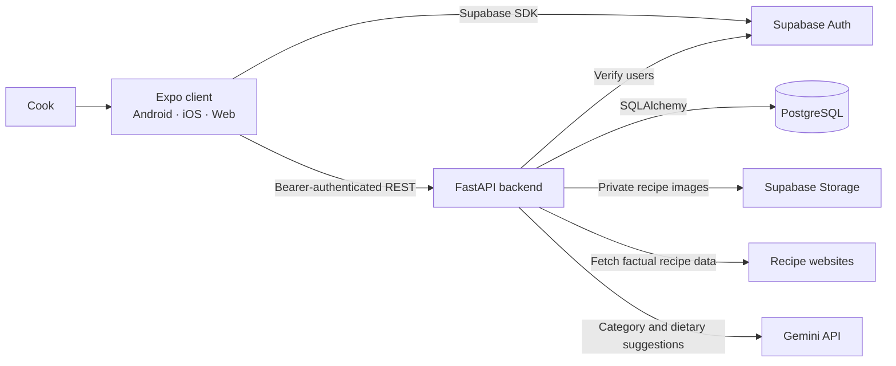

# Math Fridge

Math Fridge is a cross-platform recipe utility that turns saved or imported recipes into kitchen-ready, dynamically scalable cooking plans. It combines ratio-aware ingredient math, practical culinary rounding, AI-assisted discovery tags, and an interactive cooking mode across Android, iOS, and web.

> **Portfolio media:** A short demo video/GIF and final device screenshots will be added before the public portfolio release. The Interactive Cooking Mode and Target Yield workflow should be the primary demo sequence.

## Why it exists

Most recipe apps store static text. Math Fridge treats a recipe as a ratio-based system: cooks can change the target yield, receive readable unit conversions, override one ingredient without losing the recipe's relationships, and carry the scaled result into a step-by-step cooking session.

## Core features

- **Target Yield scaling:** Recalculates ingredients from their saved base quantities.
- **Kitchen-aware rounding:** Handles continuous measurements, whole items such as eggs, and quarter-based items such as loaves.
- **Atomic overrides:** Uses a manually adjusted ingredient as a new ratio anchor for the recipe.
- **Recipe extraction:** Parses factual recipe data from supported webpages while preserving source attribution.
- **AI-assisted discovery:** Gemini suggests cuisine, meal-type, category, seasonal, ingredient, and dietary tags.
- **Vault and Community:** Supports private recipes, publishing, bookmarks, search, category pages, and dietary filters.
- **Interactive Cooking Mode:** Provides step navigation, scaled ingredient checklists, timers, wake lock, progress restoration, and supported-device notifications.
- **Image workflow:** Accepts compressed local uploads or permitted image URLs with ownership confirmation and attribution.
- **Accessible cross-platform UI:** Includes theme selection, five text sizes, higher contrast, reduced motion, safe-area handling, and responsive recipe grids.
- **Account lifecycle:** Supports Supabase authentication, Google OAuth, profile customization, password reset, and account deletion.

## Technology stack

| Layer | Technologies |
| --- | --- |
| Client | React Native, Expo SDK 57, Expo Router, TypeScript |
| API | Python, FastAPI, Pydantic |
| Data | PostgreSQL 15, SQLAlchemy, JSONB |
| Authentication and storage | Supabase Auth, Google OAuth, Supabase Storage |
| Extraction and classification | `recipe-scrapers`, Gemini API |
| Testing | Jest, `jest-expo`, Python `unittest`, manual cross-platform E2E checklist |
| Local infrastructure | Docker Compose |

## System overview



See [System Architecture](docs/ARCHITECTURE.md) for request flows, trust boundaries, and engineering trade-offs.

## Repository layout

```text
math-fridge/
├── backend/             FastAPI, SQLAlchemy models, scraper, and Python tests
├── frontend/            Expo Router application and Jest tests
├── docs/                Architecture and setup documentation
└── docker-compose.yml   Local PostgreSQL service
```

## Quick start: four terminals

Every terminal starts from the cloned repository but remains in the directory shown below.

```text
Terminal 1 → math-fridge/           PostgreSQL
Terminal 2 → math-fridge/backend/   FastAPI
Terminal 3 → math-fridge/frontend/  Expo
Terminal 4 → math-fridge/frontend/  Jest watch mode (optional)
```

```bash
# Terminal 1 — repository root
docker compose up -d db
```

```bash
# Terminal 2 — backend/
python3 -m venv .venv
source .venv/bin/activate
pip install -r requirements.txt
cp .env.example .env
uvicorn main:app --reload --host 0.0.0.0
```

```bash
# Terminal 3 — frontend/
npm install
cp .env.example .env
npx expo start
```

```bash
# Terminal 4 — frontend/ (optional)
npm run test:watch
```

The environment files require Supabase and Gemini credentials before the complete application can run. Follow the [Setup and Deployment Guide](docs/SETUP.md) for configuration, OAuth redirects, Android networking, verification, and troubleshooting.

## Testing

```bash
cd frontend
npm test -- --verbose
npm run test:coverage
```

The current automated frontend baseline contains **47 passing tests** across scaling/unit behavior and mocked API integration contracts. The scaling engine currently has **93.75% line coverage**. A repeatable Android, iOS, and web smoke checklist is available at [frontend/tests/e2e/manual-smoke-checklist.md](frontend/tests/e2e/manual-smoke-checklist.md).

## Documentation

- [System Architecture](docs/ARCHITECTURE.md)
- [Setup and Deployment Guide](docs/SETUP.md)
- [Frontend testing guide](frontend/tests/README.md)
- [Manual E2E checklist](frontend/tests/e2e/manual-smoke-checklist.md)

## Project status

The core product is feature-complete and has been manually verified on Android, iOS, and web. Automated UI/E2E execution, production hosting, CI/CD, final portfolio media, and production security hardening are documented future improvements rather than claimed as completed work.
