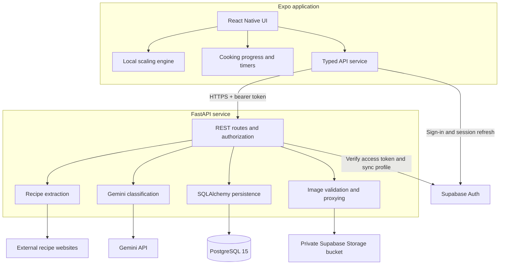
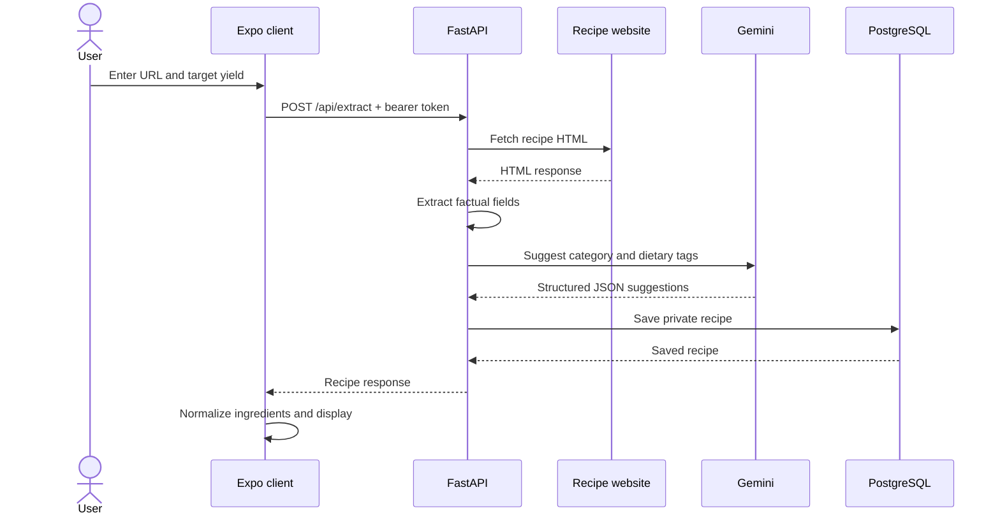
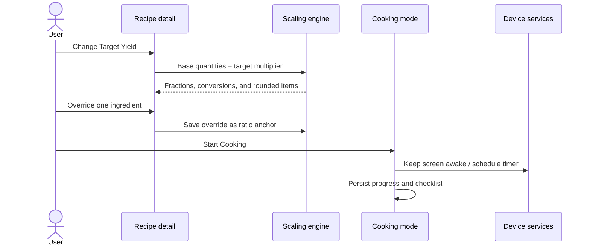

# Math Fridge System Architecture

## 1. Purpose

Math Fridge is a three-platform recipe application built around a ratio-based scaling engine. The system separates immediate cooking interactions in the Expo client from authenticated persistence, extraction, AI classification, and storage operations in the FastAPI backend.

## 2. System context

## 3. Component responsibilities

### Expo client

- Owns navigation, responsive presentation, accessibility preferences, and account UI.
- Performs Target Yield, fraction formatting, unit promotion/demotion, and atomic override calculations locally for immediate feedback.
- Stores Supabase sessions using platform-appropriate client storage.
- Restores cooking progress and coordinates in-app timers, wake lock, and supported native notifications.
- Calls the backend through a single API service with the active Supabase bearer token.

### FastAPI backend

- Defines account, recipe, publishing, bookmarking, extraction, tagging, and image routes.
- Verifies bearer tokens with Supabase Auth before owner-only operations.
- Synchronizes authenticated Supabase users into the application database.
- Fetches recipe pages and extracts factual fields such as ingredients, instructions, yield, timing, and preview images.
- Sends recipe title/ingredients to Gemini for conservative category and dietary suggestions.
- Validates JPEG uploads, stores them in a private `recipe-images` bucket, and authorizes image access through a proxy route.

### PostgreSQL

- Stores users, ownership, privacy status, discovery tags, image metadata, and recipe payloads.
- Uses relational columns for identity and lifecycle fields.
- Uses JSONB for variable-length ingredients and instructions so extracted and manual recipes share one payload shape.

### Supabase

- Auth is the source of truth for sessions and social sign-in.
- Storage holds private user-uploaded images.
- The service-role credential is restricted to the backend; the Expo client receives only a publishable/anonymous key.

## 4. Principal data flows

### Save or extract a recipe

### Scale and cook

## 5. Trust boundaries and authorization

- Client input is untrusted; authenticated ownership checks occur on the backend.
- Supabase access tokens cross the client/API boundary in the `Authorization` header.
- The Supabase service-role key never belongs in an `EXPO_PUBLIC_*` variable.
- Recipe image objects are private; the backend proxy checks whether the recipe is public or owned by the requester.
- Extracted website images remain attributed and require a user permission confirmation before Community publishing.
- AI tags are suggestions. The user can review and edit them before publication.

## 6. Engineering trade-offs

### FastAPI instead of an all-JavaScript backend

Python provides a mature ecosystem for recipe extraction, structured AI workflows, and data processing. FastAPI adds typed request validation and concise asynchronous-capable endpoints. The trade-off is maintaining TypeScript and Python toolchains instead of one language across the stack.

### Supabase instead of Firebase

Supabase combines OAuth/session management and object storage with a PostgreSQL-oriented model that matches the application's relational ownership needs. It also keeps authentication concerns out of the custom API. The trade-off is dependence on a hosted service and coordination between Supabase identity/storage and the application's PostgreSQL database.

### JSONB recipe payloads instead of normalized ingredient tables

JSONB accommodates irregular scraped recipes, preserves ingredient ordering, and lets old recipes survive new optional fields. The trade-off is weaker database-level validation and less efficient ingredient-level analytical querying.

### Local scaling instead of a backend round trip

Scaling locally makes slider feedback instantaneous and keeps cooking usable during transient network interruptions. The same base quantities and explicit scaling types make the calculation deterministic. The trade-off is that shared scaling rules must remain well-tested as the client evolves.

### AI suggestions instead of deterministic dietary claims

Gemini handles vocabulary and ingredient ambiguity that would make a regex-only classifier brittle. Conservative prompting and user review reduce false confidence. The trade-off is cost, latency, model variability, and the fact that suggestions are not medical or certification guarantees.

### Private storage with an API proxy

Private objects prevent raw public bucket access and allow ownership/publication checks. The trade-off is additional backend traffic compared with direct CDN URLs.

## 7. Current limitations and production hardening

- CORS currently permits every origin for local cross-platform development; production should use an explicit allowlist.
- Local database schema adjustments run during API startup; production should use versioned migrations such as Alembic.
- The development code contains permissive SSL handling for local certificate issues; production must restore normal certificate verification.
- The API and PostgreSQL service currently run locally; production hosting and secret management are not yet configured.
- E2E flows are documented and manually verified, but device automation and CI/CD remain future work.
- AI dietary labels are discovery aids, not nutritional, allergy, religious, or medical certifications.

## 8. Testing strategy

| Layer | Current coverage |
| --- | --- |
| Unit | Quantity parsing, ingredient classification, rounding, conversions, atomic scaling, legacy normalization |
| Frontend integration | Auth headers, Vault fallback, dietary query encoding, update/delete contracts, bookmark authorization |
| Backend | Scaling plus offline route-level authorization tests for private/public recipe access and ownership-scoped mutations; broader database fixtures remain a future enhancement |
| End-to-end | Repeatable manual Android, iOS, and web smoke checklist |

See [Setup and Deployment](SETUP.md) for commands and [the frontend test guide](../frontend/tests/README.md) for the Jest workflow.
